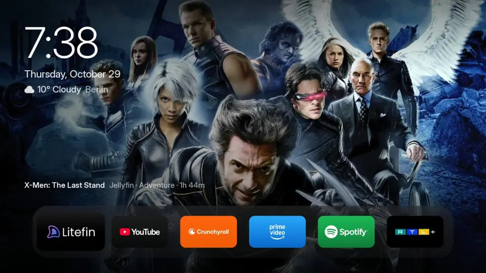

<div align="center">


# Foyer

**A calm, ad-free home screen for LG and Samsung TVs, that takes you straight to the film.**

Full-screen picks of what's trending, your apps in one dock, the time and the weather at a glance.<br>
Every pick opens where *you* watch it: your Jellyfin library, Seerr to request it, or the streaming app you pay for.<br>
Open source, made to be adapted with an AI agent like [Claude Code](https://claude.com/claude-code).

[What you get](#what-you-get) · [Where a pick opens](#where-a-pick-opens) · [Install on LG](#install-on-an-lg-tv) · [Rooted LG](#as-the-home-screen-on-a-rooted-lg-tv) · [Samsung](#samsung-tvs-tizen) · [Make it yours](#make-it-yours-with-an-ai-agent)



</div>

> Foyer started as a fork of [Free My TV](https://github.com/simbasjungles/free-my-tv) by its contributors, and keeps
> its web home screen, its LG and Samsung packaging and its Google TV app. It has since grown its own look and its own
> idea: a home screen that is a gateway to *your* media. Thank you, Free My TV.

## What you get

- **The ambient home.** While your apps have focus, a pick's photo fills the screen, sharp, a new one every 45 seconds, with the time, the date and the weather at the top left.
- **A carousel of picks.** Press ↑: the picks of this week go by over the whole screen (← →), with their title, details and story. *Explore*, *Movies*, *Shows* and *Anime* sit at the top right. OK opens the pick.
- **Every app, one press down.** ↓ shows the TV's inputs and shortcuts, then all your apps.
- **Hold OK on an app** for its menu: move it, put it on or off the dock, or uninstall it (on a rooted LG TV).
- **No ads.** No sponsored rows, banners or autoplaying promos.
- **Smooth on real TVs.** 60 fps on an LG OLED C1 (webOS 6), which draws the page at twice its size: `performance=auto` turns shadows and animations off where the TV can't keep up.
- **Day and night**, a screensaver of the picks with a big clock, 26 languages, and settings on the TV itself.

## Where a pick opens

The picks come from [TMDB](https://www.themoviedb.org/) (what's trending this week, new releases, this season's anime). What makes Foyer useful is where OK takes you, and that is up to you:

| A pick that is… | opens |
|---|---|
| in your **Jellyfin** library | [Litefin](https://github.com/MoazSalem/litefin) (or the Jellyfin app) |
| not in your library | Litefin's **Seerr** page, to request it |
| anime on **Crunchyroll** | Crunchyroll |
| on **Netflix, Prime Video, Disney+**, Max, Apple TV… in your country | that app |

### Litefin: straight to the title

[**Litefin**](https://github.com/MoazSalem/litefin) is a fast Jellyfin client for TVs with Seerr built in. Its next
version takes launch parameters ([MoazSalem/litefin#559](https://github.com/MoazSalem/litefin/pull/559), merged into
`development`), so a pick from Foyer opens **on the title itself**: its page in your library, or Seerr's page to
request it. One press from the sofa to the film. Until that version is out, build Litefin from its `development`
branch; with the released version a pick opens Litefin's home.

```properties
jellyfin_url=http://192.168.1.20:8096
jellyfin_key=…            # Jellyfin: Dashboard → API Keys → +
picks_from=jellyfin       # the picks are what's popular today: yours open in Jellyfin, the rest go to Seerr
anime_tab=true
```

### Netflix, Prime Video and the others

Any streaming app on the TV can take the picks it streams in your country (`picks_from=all`, the default): TMDB says
which service has a title, and Foyer opens that app. Today they open on the app's home. Most apps also take a title
when they're opened, each in its own way. That is exactly the kind of change to make with an AI agent (below): the
mapping is a short list in [`web/data.js`](web/data.js) (`SERVICES`), and the launch parameters are one function in
[`web/home.js`](web/home.js) (`pickParams`), where Litefin's are.

## Make it yours, with an AI agent

Foyer is small, plain code (HTML, CSS and ES5 JavaScript, no frameworks), written to be changed by an AI coding agent.
The easiest way to set it up for your apps, your TV and your taste: open the folder in
[Claude Code](https://claude.com/claude-code) (or another agent) and say what you want. [CLAUDE.md](CLAUDE.md) tells it
how the project works and how to test on the TV. Try:

- *"Install Foyer on my LG TV at 192.168.1.50. I live in Berlin, and my Jellyfin server is at 192.168.1.20."*
- *"When a pick is on Netflix, open Netflix on that title."*
- *"Add Plex as a place the picks can open, like Jellyfin."*
- *"Put YouTube, Litefin and Spotify on the dock, in that order."*
- *"Show the carousel's picks only from my library."*
- *"Make the clock smaller and move the weather under it."*

It reads the code, makes the change, builds the package and installs it on your TV, and asks before anything important.

## Install on an LG TV

You need an LG TV (webOS 3 or newer) and a computer on the same Wi-Fi, with Python 3. Nothing on the TV is rooted or
changed; LG's home screen stays where it is.

1. **On the TV**, open the LG Content Store and install **Developer Mode**. Sign in with a free [LG developer account](https://webostv.developer.lge.com), turn on **Dev Mode Status** (the TV restarts), then turn on **Key Server**. Write down the IP address and the passphrase it shows.
2. **On your computer**, get the code and build. The first build creates `config.properties`: set your city, your [TMDB key](#the-tmdb-key) and, if you like, Jellyfin (see [Settings](#settings)). Then build again:
   ```bash
   git clone https://github.com/dfraenky/foyer-tv && cd foyer-tv
   python3 webos/build.py
   ```
3. **Install.** The first time, it asks for the TV's passphrase; updates don't:
   ```bash
   python3 webos/install.py 192.168.1.50
   ```
4. **On the TV**, while Foyer is open, hold a number key on the remote: from then on that key opens it from anywhere.

On webOS 6 and newer, LG doesn't let Developer Mode apps see the TV's apps. Foyer then asks the TV, once, for the
access LG's phone app uses: allow it, and from the next start all your apps show, with their icons. On webOS 3, run
`python3 webos/apps.py 192.168.1.50` before building, so the list is built in.

Developer Mode lasts about 40 days: open the Developer Mode app now and then and press **EXTEND**. To remove Foyer:
`python3 webos/install.py 192.168.1.50 --uninstall`.

### As the home screen, on a rooted LG TV

On a TV rooted with the [webOS Homebrew Channel](https://github.com/webosbrew/webos-homebrew-channel) (root SSH on, your key in it), Foyer takes over from LG's home screen:
```bash
python3 webos/install.py 192.168.1.50 --root --launcher
```
- **Closing an app** comes back to Foyer, and so does anything else that brings up LG's home screen. A small watcher started at boot (`webos/root/`, in `/var/lib/foyer`) does it.
- **Turning the TV on** opens Foyer instead of Live TV. An HDMI input the TV wakes up on stays, for a console or player that turned it on.
- **The Home key** opens Foyer, through [LG Input Hook](https://github.com/Simon34545/lginputhook) (install it from the Homebrew Channel and open it once).
- **Uninstalling** from an app's menu (hold OK) goes through the same watcher, since the TV doesn't let a page do it. It listens on 127.0.0.1:7172, refuses websites, and never removes LG's own apps, apps built into the TV or the Homebrew Channel.
- **LG's home screen** is still there: *LG Home* among the shortcuts opens it and stays.

`--no-launcher` gives Home and the closed apps back to LG's home screen. Tested on an LG OLED C1 (webOS 6.5.3).

## Samsung TVs (Tizen)

The same home screen as a Samsung app (Tizen, 2015 or newer), installed through Samsung's Developer Mode:

1. **On the TV**, open **Apps** and type `1 2 3 4 5` on the remote. Turn **Developer mode** on, type your computer's IP address in **Host PC IP**, and restart the TV.
2. Build `python3 tizen/build.py` and install with `python3 tizen/install.py 192.168.1.50` (only Python needed). On 2023 and newer TVs the package has to be signed with your Samsung account: ask your AI agent to set that up.
3. In the TV's settings, under Start Screen Options, turn on **Autorun Last App**: the TV turns on into Foyer.

## Settings

The first values come from `config.properties` (created by the first build, never committed). Most can also be changed
on the TV, in *Home Settings* (↓, then the shortcut), and the TV's choice wins.

| Key | What it does | Default |
|---|---|---|
| `tmdb_key` | Your free TMDB key, for the picks | empty |
| `tmdb_region` | Your country (two letters): which titles are on which app | `US` |
| `jellyfin_url`, `jellyfin_key` | Your Jellyfin server and an API key: titles in your library open there | empty |
| `picks_from` | `all`, or `jellyfin`: the picks are what's popular today, opening Jellyfin (Litefin when installed) when in your library and Seerr otherwise | `all` |
| `anime_tab` | `true` adds an Anime tab: this week's trending anime, then the season airing now | `false` |
| `ambient_home` | `false` keeps the classic layout: title, tabs and poster cards above the dock | `true` |
| `hero_card` | Classic layout only: `false` keeps every card narrow | `true` |
| `performance` | `auto`, `full`, `calm` (only movement animates) or `lite` (no shadows or animations) | `auto` |
| `latitude`, `longitude`, `city` | Your city, for the weather and the sunset | New York |
| `language` | `auto` (follows the TV) or a language code (`en`, `de`, `fr`, `ja`…) | `auto` |
| `temperature`, `theme` | `C`, `F` or `auto`; `auto`, `light` or `dark` | `auto` |
| `show_crypto`, `currency` | Crypto prices (classic layout's drawer) | `true`, `USD` |
| `hide_animation` | Leave cartoons and anime out of the picks | `false` |
| `hide_apps` | Apps to leave out everywhere, by id or name, comma separated | empty |
| `shelf_apps` | The dock's apps in this order, by id or name; wins once over the dock picked on the TV | empty |
| `drawer_first` | `true` opens with the apps' drawer already out | `false` |

### The TMDB key

Free, and it takes two minutes: create an account at [themoviedb.org](https://www.themoviedb.org/signup), open
[Settings → API](https://www.themoviedb.org/settings/api) and request a developer key. Put it after `tmdb_key=`, or type
it on the TV in *Home Settings* → *TMDB key* (the short 32-character *API Key* is easier with a remote).

## How it works

- **Plain HTML, CSS and JavaScript** ([`web/`](web)), written for the Chromium of older TVs (ES5, no CSS variables, no frameworks). Only transform and opacity animate, and the background photos are plain images, so a TV's GPU keeps up.
- [`webos/build.py`](webos/build.py) packs it with `config.properties` into an `.ipk` without LG's tools; [`webos/install.py`](webos/install.py) installs it through Developer Mode, or over root SSH. On LG it lists and opens apps through the TV's service bus (Luna), as LG's launcher does. [`tizen/build.py`](tizen/build.py) makes the Samsung `.wgt`.
- [`webos/root/`](webos/root): on a rooted LG TV, the watcher (Node, started at boot) that makes Foyer the home screen and uninstalls apps for it.
- **Data** from TMDB (picks, which app streams what), your Jellyfin server, and Open-Meteo (forecast, sunrise and sunset).
- To preview it on a computer: `python3 webos/build.py --preview`, then open `out/webos/index.html`.

| File | What it is |
|---|---|
| [`web/home.js`](web/home.js) | The home screen: ambient view, carousel, dock, apps, menus, settings |
| [`web/data.js`](web/data.js) | The picks (TMDB, Jellyfin), where each opens (`SERVICES`), the weather |
| [`web/tv.js`](web/tv.js) | The TV's apps, inputs and keys, on LG and Samsung |
| [`webos/root/launcher.js`](webos/root/launcher.js) | The rooted LG TV's watcher |

The Google TV and Android TV app inherited from Free My TV is still in [`app/`](app) (renamed, built with
[`build.sh`](build.sh)), but Foyer doesn't develop it further: for Google TV, use
[Free My TV](https://github.com/simbasjungles/free-my-tv).

## Translations

Each language is one file, [`app/assets/i18n/<lang>.json`](app/assets/i18n), keyed by the English text in the code; 26
languages today. After changing text, `python3 tools/translate.py --check` lists what each language lacks.

## Privacy

No accounts, no analytics, no tracking. The TV talks to TMDB, Open-Meteo (with your city's coordinates), your Jellyfin
server when you set one, and Binance only when `show_crypto=true`. Your settings stay on your computer and your TV.

## Credits

- Based on [Free My TV](https://github.com/simbasjungles/free-my-tv) (MIT), by its contributors.
- The LG version builds on what [@danielthejoker18](https://github.com/danielthejoker18) found in [FreeMyTvWebOS](https://github.com/danielthejoker18/FreeMyTvWebOS) (MIT).
- [Litefin](https://github.com/MoazSalem/litefin) by [@MoazSalem](https://github.com/MoazSalem); [LG Input Hook](https://github.com/Simon34545/lginputhook); the [webOS Homebrew Channel](https://github.com/webosbrew/webos-homebrew-channel).
- The ambient home was inspired by ProjectHiten, a home replacement for rooted LG TVs shown on r/webos.
- This product uses the TMDB API but is not endorsed or certified by [TMDB](https://www.themoviedb.org/).
- Weather data by [Open-Meteo.com](https://open-meteo.com/) (CC BY 4.0).
- Icons: [Material Symbols](https://fonts.google.com/icons) (Apache 2.0). Font: [Inter](https://rsms.me/inter/) (SIL OFL 1.1).
- Built with [Claude Code](https://claude.com/claude-code).
- Not affiliated with LG, Samsung, Google, Jellyfin or any streaming service. App names and logos belong to their owners.

## License

[MIT](LICENSE). Fork it, change it, ship it.
